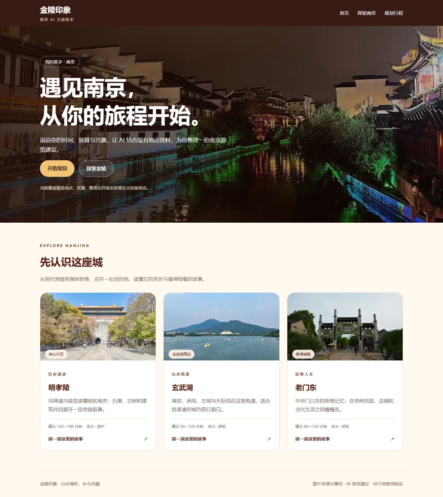
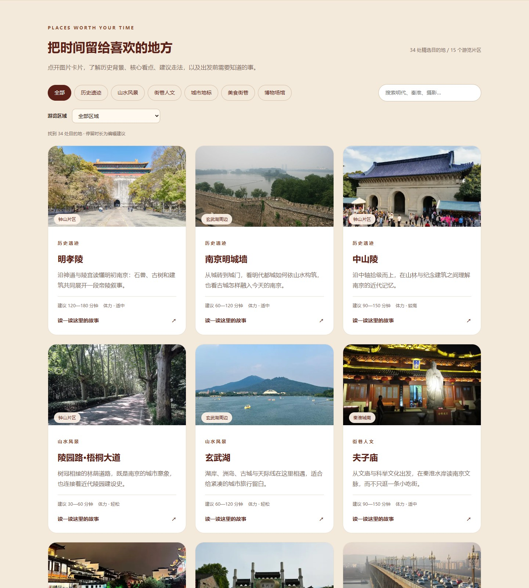

<p align="center">
  
  
  
  
  
  
</p>

<h1 align="center">金陵印象 · Jinling Impressions</h1>

<p align="center">从一座城的故事出发，规划属于你的南京旅程。</p>

<p align="center">
  <a href="#功能亮点">功能亮点</a> ·
  <a href="#快速开始">快速开始</a> ·
  <a href="#配置说明">配置说明</a> ·
  <a href="#开发与测试">开发与测试</a> ·
  <a href="#项目文档">项目文档</a>
</p>



金陵印象是一款面向南京旅行的 AI 文旅应用，将城市文化阅读、目的地探索与个性化行程规划连接起来。输入时间、预算、出发位置和兴趣，即可获得包含看点、活动、餐休、区域衔接与资料来源的游览建议。

## 团队与项目来源

| 项目 | 信息 |
| --- | --- |
| 团队名称 | 从容面对 |
| 团队编号 | 40409 |
| 所属院校 | 南京航空航天大学金城学院 |
| 参赛组别 | B组 |
| 团队人数 | 2人 |

项目基于学校 Web 课程的小组作业改造，原型是介绍南京的 HTML、CSS 和 JavaScript 静态网站。本次重构为 Next.js 应用，扩充目的地与图库，增加真实模型规划、规则校验、任务恢复、用量反馈和版本修改。项目此前未参加其他比赛，未获得比赛奖项。

## 功能亮点

| 功能 | 体验 |
| --- | --- |
| 城市文化读本 | 从六朝、明代、近代与当代生活认识南京，建立游览线索。 |
| 目的地探索 | 浏览 30 处目的地，支持分类、区域、别名搜索与独立图文详情。 |
| 个性化攻略 | 按半日、一日或两日组织路线，结合兴趣、预算和步行偏好。 |
| 资料与约束检查 | 检查必选和排除地点、时段、体力、区域折返及参考费用。 |
| 行程持续调整 | 在原方案上修改需求，保留最近 5 个版本，随时切换查看。 |
| 生成过程可见 | 展示等待时间、模型耗时和实际 token 用量；刷新可恢复已有任务。 |

### 一段完整的游览体验

1. 在「探索金陵」中了解目的地的历史、看点与出行参考。
2. 将感兴趣的地点带入规划，补充出游条件。
3. 查看每日主线、具体玩法、用餐建议与费用范围。
4. 提出调整要求，比较新旧版本，确定适合自己的节奏。

<details>
<summary>查看探索页预览</summary>



</details>

## 快速开始

需要 **Node.js 22.16 或以上版本**，以及 npm。

下载或克隆项目后，可在项目目录直接运行启动脚本：

| 系统 | 命令 |
| --- | --- |
| Windows | 双击 `start.bat`，或在终端运行 `.\start.bat` |
| Linux / macOS | `sh ./start.sh` |

脚本会检查环境，首次启动创建 `.env.local`、安装缺失依赖，然后构建并启动生产服务。已有配置会保留；在 `.env.local` 填入 `AI_API_KEY` 可启用模型生成。默认端口为 `3000`，监听全部网卡，按 `Ctrl+C` 停止。

可通过环境变量 `JINLING_PORT` 指定其他端口，例如 `JINLING_PORT=3001 sh ./start.sh`；PowerShell 使用 `$env:JINLING_PORT='3001'; .\start.bat`。

也可以手动安装并启动开发服务：

```bash
git clone https://github.com/tuanliubuxi/jinling-impressions.git
cd jinling-impressions
npm ci
cp .env.example .env.local
```

在 `.env.local` 填入 DeepSeek API Key，然后启动：

```bash
npm run dev
```

打开 [http://localhost:3000](http://localhost:3000)。不配置模型密钥也可浏览首页与目的地资料。

> Windows PowerShell 可使用 `Copy-Item .env.example .env.local` 复制配置，并以 `npm.cmd` 替代 `npm`。

## 配置说明

| 变量 | 默认值 | 用途 |
| --- | --- | --- |
| `AI_API_KEY` | 留空 | DeepSeek API Key，仅在服务端读取。 |
| `AI_BASE_URL` | `https://api.deepseek.com` | DeepSeek 官方 API 地址。 |
| `AI_MODEL` | `deepseek-flash` | 生成攻略所用模型。 |
| `DEV_ALLOWED_ORIGINS` | `**.cpolar.top` | 额外允许的开发主机名，多个值以逗号分隔。 |
| `PUBLIC_APP_ORIGINS` | 见 `.env.example` | 代理改写 Host 时的公开来源，包含协议。 |

以上为应用配置；`JINLING_PORT` 为启动脚本可选端口参数，默认 `3000`。核心依赖及版本见 `package.json`，完整依赖锁定见 `package-lock.json`。评审复现建议使用 `npm ci` 安装锁定版本。

开发服务启动时自动识别本机网卡 IPv4。同一局域网的设备可通过运行服务的电脑 IP 访问；切换网络后重启开发服务即可。通配符 `*` 匹配单级子域，`**` 匹配多级子域。

`.env.local`、构建缓存、运行任务和依赖目录均由 Git 忽略。模型密钥使用服务端环境变量，不添加 `NEXT_PUBLIC_` 前缀。

## 构建与运行

```bash
npm run build
node node_modules/next/dist/bin/next start --hostname 0.0.0.0 --port 3000
```

应用需要 Node.js 服务端运行环境。任务保存在 `.local/plan-jobs`，保留 24 小时；单实例部署应提供可写的持久磁盘。多实例或无持久磁盘环境需接入共享存储与共享限流。

## 技术架构

- **Next.js App Router + React**：页面、路由与服务端模型接入使用同一工程。
- **TypeScript**：共享请求契约、地点类型与输出校验规则。
- **原生 CSS**：以酒红、暖金与纸色构建城市阅读界面，适配移动端。
- **DeepSeek API**：检索本地资料后生成结构化攻略，服务端校验再展示。
- **会话存储 + 文件持久化**：恢复任务、保存结果与版本，并以任务编号防止重复生成。

```text
src/
├── app/                 页面与 API 路由
├── components/          共享界面组件
├── data/                地点、文化与出行参考
├── features/            探索与规划功能
├── lib/                 模型接入、校验与任务管理
└── types/               共享类型
public/images/           页面图片
docs/                    技术文档与项目预览
scripts/                 集成测试与评估工具
tests/                   单元测试
```

## 开发与测试

```bash
npm test
npm run typecheck
npm run build
```

HTTP 检查、移动端交互回归与真实模型评估见[开发与测试指南](docs/development.md)。默认单元测试和模拟浏览器回归不调用模型；真实模型评估需要显式传入 `--live`，会产生 API 费用。

## 数据与使用边界

- 地点资料附参考来源，门票与开放信息注明适用范围和核对日期。
- 转场时间与餐饮预留属于编辑参考，不是实时导航、实际报价或已完成的预约。
- 未收录的目的地及明显冲突的条件会提示调整；模型输出仍需结合官方信息核实。
- 刷新、查询与切换已保存版本复用结果；重新生成和修改行程会创建新的模型任务。
- 当前 AI 工作流是本地规则检索增强与结构化工具输出，不包含自主 Agent、MCP 客户端、图像理解、语音输入或流式生成。图库属于内容展示，不作为多模态 AI 能力宣称。

## 项目文档

| 文档 | 内容 |
| --- | --- |
| [技术架构](docs/architecture.md) | 数据流、接口与任务持久化。 |
| [行程规划规则](docs/planner-quality.md) | 时间、体力、预算参考及版本管理。 |
| [内容维护指南](docs/content-guide.md) | 目的地资料结构、来源与扩充流程。 |
| [开发与测试](docs/development.md) | 本地验证、浏览器回归与 API 评估。 |
| [手机与远程验收](docs/acceptance.md) | 真机操作、需求覆盖与任务恢复检查。 |
| [素材说明](docs/assets.md) | 图片清单、内容来源与使用范围。 |
| [提交与复现说明](docs/submission.md) | 仓库要求、真实开发历史与评审运行步骤。 |
