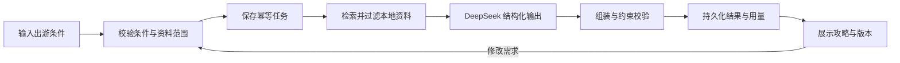

# 技术架构

## 工程组成

Next.js App Router 承载页面与 API；React 和原生 CSS 构建响应式界面，TypeScript 定义地点、请求与结果契约。模型通过服务端原生 `fetch` 接入，密钥不发送到浏览器。

资料来自 `src/data`。检索采用地点名称、同义词和主题标签匹配，最多提供 8 个候选的详细内容；该流程不依赖联网搜索或向量数据库。

## 规划数据流

DeepSeek 使用严格工具参数返回扁平字段，服务器组装每天的站点与活动。结构、地点白名单、重复地点、时段、必选和排除项、体力与已知费用均经本地检查；模型异常不会自动触发新一轮生成。

## API

| 接口 | 行为 |
| --- | --- |
| `GET /api/health` | 返回服务状态与模型配置是否完整，不代表模型服务连通。 |
| `POST /api/plan` | 提交规划或修改，须携带 UUID 格式的 `Idempotency-Key`。 |
| `GET /api/plan?requestId=...` | 只查询已有任务，不发起生成。 |

任务状态为 `pending`、`completed` 或 `failed`。相同编号、相同输入复用任务；相同编号更换输入返回 409。请求体上限为 8 KiB，新任务按进程限制为 2 个并发、每分钟 10 次，上游超时为 90 秒。

## 恢复与持久化

- 浏览器会话存储保存当前输入、任务及最近 5 个版本。
- 服务端 `.local/plan-jobs` 保存任务、结果与用量，保留期为 24 小时。
- 刷新与继续查看只查询已有任务；暂停等待不取消后台生成。
- 重启前尚未完成的任务标记为中断，避免自动重复调用模型。

文件持久化适用于有可写持久磁盘的单实例服务。多实例部署需要共享存储与共享限流。任务结果可能包含出发位置等输入信息，应按运行环境的访问控制与数据保留要求管理。

## 来源校验

普通请求按浏览器 Origin 与实际 Host 校验。代理改写 Host 时，使用 `PUBLIC_APP_ORIGINS` 中的公开来源匹配规则；协议、端口和域名标签边界分别检查。开发资源额外允许本机网卡地址与 `DEV_ALLOWED_ORIGINS` 指定的主机名。
